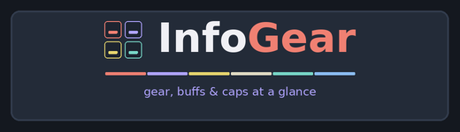
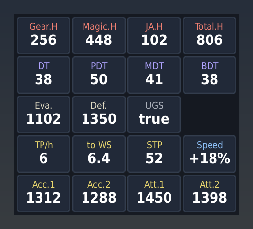
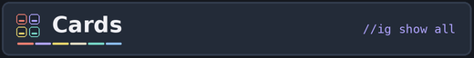
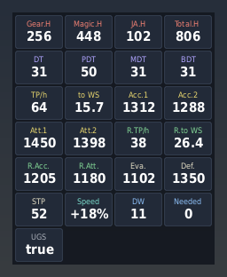
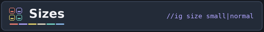
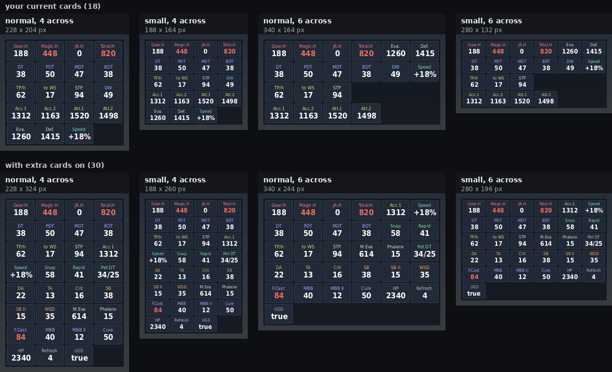
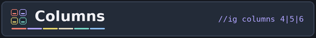
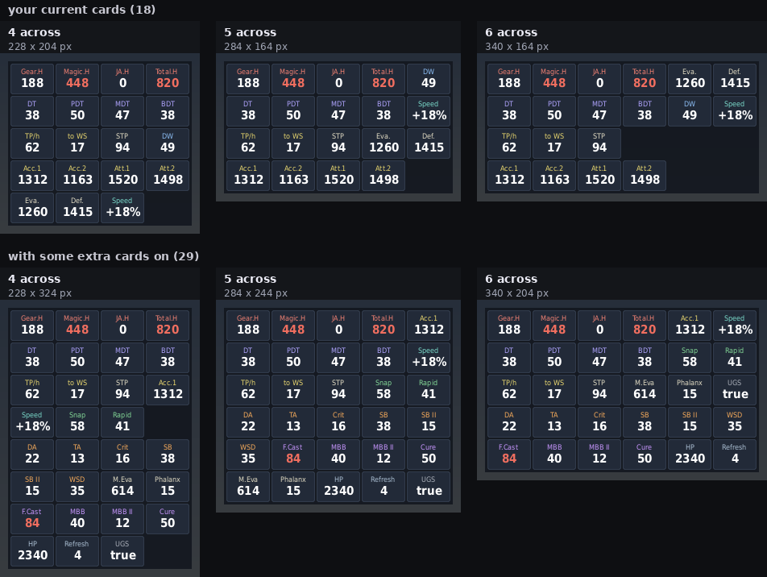
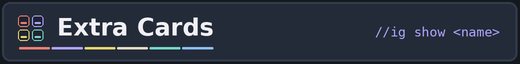
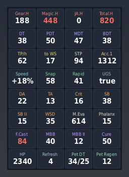

# InfoGear v1.30

InfoGear is a patched and restructured fork of **GearInfo** by Sebyg666 (https://github.com/sebyg666/GearInfo),
based on GearInfo 1.7.2.9. See CHANGES.md in the package for everything that was fixed or changed.



This is a multi-purpose addon that tracks your currently equipped gear and buffs to display valuable information.



The addon can be used in conjunction with Gearswap to facilitate gear swapping.

**Commands:** `//ig` or `//infogear` (the original used `//gi`). `//ig help` lists the topics, `//ig help <topic>` or
`//ig help <command>` the details. The Gearswap command is still `gs c gearinfo ...`, so existing Gearswap files keep working.

## Commands (v1.30)

Toggles take an optional `on` / `off` (without one they flip); commands that take a number show the current value
when typed without one. A card's name on its own toggles it (`//ig da` = `//ig show da`), and a mistyped command
suggests the closest one. Old spellings still work (`//ig s wstp`, `//ig ugs true`, `//ig show cor`...).

| command | what it does |
|---|---|
| **Display** | |
| `//ig columns 4\|5\|6` | Cards per row (4 = default). (also `cols`) |
| `//ig size normal\|small` | Card size; small = smaller cards and text. |
| `//ig scale <0.5-2>` | Size of the whole display (1 = normal). |
| `//ig lock [on\|off]` | Lock the display so it can't be dragged. |
| `//ig hover [on\|off]` | Breakdown box when the mouse is over a card. |
| `//ig cutscene [on\|off]` | Hide the display during cutscenes. |
| **Cards** | |
| `//ig cards` | List every card and group, * = shown. |
| `//ig show <card\|group\|all> [on\|off]` | Turn cards on (flips without on / off). |
| `//ig hide [card\|group\|all]` | Turn cards off; on its own: all of them. |
| `//ig jobcards [on\|off]` | Each main job keeps its own cards. |
| **Looking into the numbers** | |
| `//ig why dt\|pet` | What each item gives to your DT / your pet's DT. |
| `//ig snap <name> \| snap del <name>` | Save every card's value under a name. |
| `//ig diff <name>` | What changed since that snapshot. |
| `//ig snaps` | List your snapshots. |
| `//ig eva [number]` | Your target's evasion, for the Hit % card (/check adds its level). |
| `//ig settings` | Show your current InfoGear settings. (also `status`) |
| **Buffs, food and party** | |
| `//ig food [name\|off]` | The food InfoGear counts; set or clear it by hand. |
| `//ig sanction regen\|refresh\|food` | The bonus you picked for Sanction. |
| `//ig sigil regen\|refresh\|food` | The bonus you picked for Sigil. |
| `//ig regen [number]` | HP per tick added to Regen spells on you (caster's potency). |
| `//ig refresh [number]` | MP per tick added to Refresh spells on you. |
| `//ig brd [bonus] \| add <name> <bonus> \| del <name>` | Bards' song bonus (March etc.). |
| `//ig cor [bonus] \| add <name> <bonus> \| del <name> \| msgs` | CORs' Phantom Roll +#; msgs = roll chat messages. |
| `//ig geo [bonus] \| add <name> <bonus> \| del <name>` | GEOs' Geomancy +#. |
| `//ig dnc [on\|off]` | Haste Samba comes from a main DNC. |
| **Adding numbers by hand (until reload)** | |
| `//ig stp [number]` | Store TP to add (0 clears). |
| `//ig dw [number]` | Dual Wield to add. |
| `//ig dwn [number]` | Dual Wield needed to add. |
| `//ig ghaste [number]` | Gear Haste to add. |
| `//ig mhaste [number]` | Magic Haste to add. |
| `//ig jahaste [number]` | Job Ability Haste to add. |
| `//ig manual [clear]` | List the numbers added by hand / clear them all. |
| **Gearswap** | |
| `//ig ugs [on\|off]` | Send haste / DW to Gearswap automatically. (also `updategs`) |
| `//ig update` | Send to Gearswap once now. |
| `//ig wstp save\|clear` | Keep your current TP per hit as a second line / remove it. (also `save`, `s`, `delete`, `d`) |
| **Other** | |
| `//ig rank [number]` | Your Unity rank (for Unity gear). |
| `//ig parse` | Read all your gear again (after changing Unity rank). |
| `//ig reload` | Reload InfoGear, keeping party and buffs. (also `r`) |
| `//ig debug [on\|off]` | Debug messages. |
| `//ig help [topic\|command]` | This list; e.g. //ig help buffs, //ig help show. (also `?`) |

The original wiki (https://github.com/sebyg666/GearInfo/wiki) still describes the features; replace `//gi` with `//ig`.

## Display (v1.4)

The widgets are drawn as flat dark cards, 4 across (228 px wide, the same width as the original), each with a small coloured caption over a big bold number, on a
plain dark panel. A number over its cap turns soft red. The old bracket tiles, header strips and logo are gone;
the only art is `textures/cards/card.png` and `textures/cards/panel.png`.





* Which cards are shown is still set with `//ig show ...` (`//ig show all`, `//ig hide`).
* **Speed** card (on by default, `//ig show speed` to toggle): your movement speed as +/- %, the same number as
  Windower's SpeedChecker addon (the game's own speed value, so gear, Flee, Bolt's Role, slows and weight all count;
  on a mount it's the mount's speed against walking). Red while you're slower than normal.
* `//ig scale <0.5-2>` resizes the whole display (1 = normal). Saved per character.
* `//ig columns 4|5|6` sets how many cards go in a row (4 by default, the original width). Wider is shorter:
  with 18 cards, 4 across is 228 x 204 px, 5 across 284 x 164, 6 across 340 x 164. The cards stay in their groups (below). Saved per character.
* `//ig size small|normal` (v1.14): small cards (44 x 30 px instead of 54 x 38) with smaller text (6 / 9 pt
  instead of 7 / 11), about a third less space; columns and grouping stay as they are. Saved per character. With 18
  cards: normal 4 across 228 x 204, small 188 x 164; 6 across 340 x 164 / 280 x 132. Sizes are `card_sizes` in
  `Layouts.lua`. (`//ig scale` still works on top of either.)

  

  
* **Grouping** (v1.28): every card sits in a small group of cards that belong together, and the groups in
  sections, each with its own caption colour, always in this order:

  | section | groups (colour) |
  |---|---|
  | attack speed | Gear.H / Magic.H / JA.H / Total.H, then DW + Needed, MA + Needed (red, DW / MA blue) |
  | defence | DT / PDT / MDT / BDT, then Eva. / Def. / M.Eva / MDB, then Phalanx / Enmity / SIRD (lavender, Eva. etc. cream) |
  | melee | TP/h / to WS / aft WS / STP, Acc / Att, DA / TA / QA, Crit / Crit.D, WSD / PDL, SB / SB II (yellow) |
  | ranged | R.TP/h / R.to WS / R.aft WS, R.Acc / R.Att, Snap / Rapid (green) |
  | magic | F.Cast / Cons.MP, M.Acc / MAB / MBB / MBB II, Cure / Cure II (purple) |
  | recovery | HP / MP, Regen / Refresh / Regain (teal) |
  | pet | Pet DT / Pet Regen (mint) |
  | anywhere | Speed, TH and UGS take the lowest free space |

  A group that fits in a row is never split. A section starts where the last one ended. It only uses the free space
  in that row out of order when doing so saves a whole row, so the panel stays as small as before. The order and
  the groups are `card_groups` at the top of `Layouts.lua`, and the colours are `card_section_colors`.

  

  
* Drag the panel to move it, as before. `//ig lock` (v1.29) locks it in place so it can't be dragged by accident
  (the hover box still works); `//ig lock` again unlocks it.
* **Cutscenes** (v1.29): the display hides during cutscenes and comes back after. `//ig cutscene` turns this off.
* **Extra stat cards** (v1.7), off until you turn them on (except Regen / Refresh / Regain, on since v1.26). `//ig cards` lists them; `//ig show <name>` toggles
  one, `//ig show <group>` a whole group:

  | group | cards (name) | red when |
  |---|---|---|
  | `melee` | DA `da`, TA `ta`, QA `qa`, Crit `crit`, Crit.D `critdmg`, SB `sb`, SB II `sb2`, WSD `wsd`, PDL `pdl` | SB over 50; SB II over 50, or SB + SB II over 75 |
  | `ranged` | Snap `snap`, Rapid `rapid` | Snapshot over 70 |
  | `magic` | F.Cast `fc`, M.Acc `macc`, MAB `mab`, MBB `mbb`, MBB II `mbb2`, Cure `cure`, Cure II `cure2`, Cons.MP `conserve` (v1.27) | Fast Cast over 80, MBB over 40, Cure over 50, Cure II over 30 |
  | `tank` | M.Eva `meva`, MDB `mdb`, Phalanx `phalanx`, Enmity `enmity`, SIRD `sird` (Spell interruption rate down, v1.27) | SIRD over 102 |
  | `recovery` | Regen `regen`, Refresh `refresh`, Regain `regain` (v1.26, **on by default**): HP / MP / TP per tick from your gear **plus your buffs**: Regen / Refresh spells, Paeon, Ballad, Dancer's / Evoker's / Tactician's Roll, GEO Regen / Refresh bubbles | |
  | `misc` | HP `hp`, MP `mp`, TH `th` | |
  | `pet` | Pet Regen `petregen`: the Regen your gear gives your pet (every pet type together). Pet DT `petdt`: your pet's damage taken from your gear, **physical / magic** (e.g. `34/25`), every pet type together (Pet, Wyvern, Avatar, Automaton, Luopan lines, plus the DRG JSE neck's Wyvern DT). Only shown on a pet job: main BST, DRG, SMN, PUP or GEO, or /SMN, /BST. The pet's innate damage taken is added on top: the wyvern's -40% on DRG, the luopan's -50% on GEO (v1.29) (gear part capped at 50, total at 87.5). Avatars, automatons and jug pets have none listed | either number over 50 |

  Regen / Refresh from a **spell** count the tier InfoGear saw cast on you, at the spell's base value (Regen 5 / 12 /
  20 / 30 / 40, Refresh 3 / 6 / 9, BG-Wiki); the caster's own bonuses (Regen potency gear, Light Arts, merits) can't be
  seen, so add them yourself with `//ig regen <n>` / `//ig refresh <n>` (v1.29): that many HP / MP per tick are added
  to every Regen / Refresh spell on you (e.g. `//ig regen 12` if your WHM's gear adds 12). Companion's Roll is added to
  Pet Regen.

  These are **your gear's** numbers (augments and set bonuses included), plus buffs InfoGear tracks for the same
  stat (GEO bubbles, rolls), food and Ionis etc.
  **Job traits, merits and job points** (v1.29) are added too, so the cards show your real totals:

  | card | job part |
  |---|---|
  | DA | WAR trait 10 (main or /WAR), WAR merits +1 each, WAR job point gifts (up to +10) |
  | TA | THF trait 5 / 6 (lv 95), THF merits +1 each, THF gifts (up to +8): 19 at most |
  | Crit / Crit.D | Critical Hit Rate merits +1 each, WAR gifts; Crit.D: WAR / THF / DRK / DRG / DNC gifts |
  | SB | MNK / NIN / DNC traits (main or sub), MNK gifts, DNC's job point tiers: MNK 35, DNC 32, NIN 27 at most |
  | WSD | job point gifts (WAR...) |
  | F.Cast | RDM trait (main 30, /RDM 15) + RDM gifts: 38 at most |
  | MAB | BLM trait up to 40, RDM up to 28 (main or sub), gifts |
  | Cons.MP | GEO trait up to 43, BLM 31, SCH 28 (main or sub) |
  | M.Acc / M.Eva / MDB | job point gifts |
  | TH | THF trait 1 / 2 (lv 45), /THF 1 |
  | SIRD | Spell Interruption Rate merits, 2 each |

  The job part is listed on its own in the hover box. Blue Mage traits from set spells and WHM's Cure Potency gifts
  aren't counted. The values are in `Card_Traits` at the bottom of `Job_Traits.lua` (BG-Wiki / FFXIclopedia).
  The first time 1.7 loads on a character it reads your saved gear again (one time, chat says so), so the new stats
  are known.

  

  
* **JSE neck ranks** (v1.10): the augmentable JSE necks (Futhark Torque, Knight's Beads, War. Beads... all 22 jobs,
  base / +1 / +2) get their rank bonuses added, e.g. Futhark Torque +2 R25: Damage taken -7%, HP+60, STR/MND+15.
  Windower can't read these from the item, so they come from `res/JSE_Neck_Ranks.lua` (max-rank values from
  [BG-Wiki](https://www.bg-wiki.com/ffxi/Category:JSE_Necks)). Exact at max rank; below it they are scaled by rank.
* **Limbus ranked accessories** (v1.11): Murky Ring, Murky Mantle, Alabaster Earring, Alabaster Mantle get their
  rank bonuses, exact for every rank R1-R30 (`res/Limbus_Ranks.lua`, from the FFXIAH thread "Augment Tables for
  Limbus Gear (r1 to 30)"). The Limbus racial armor (Hope / Trust / Bravery / Justice / Mercy sets, NQ / HQ1 / HQ2)
  and the Limbus weapons (Skia ... Telopanos) get their rank bonuses too (v1.20, `res/Limbus_Armor_Ranks.lua`): every
  armor piece ranks up the same way (the growth depends only on a stat's R30 value), reproducing the BG-Wiki tables
  of Sworn Crown / Sabatons, Prestige Platemail, Duty Crown, Clemency Somen and Revelation Platemail; R30 is exact.
  Weapons follow Telopanos Grip's table (every stat from R1), so the grips are exact at every rank.
* **Unity gear** (v1.11): all 215 Unity reward items, regenerated from the game's own item descriptions; items with
  two Unity stats (e.g. Imp. Wing Hairpin DEX and AGI) get both. Set your Unity rank with `//ig rank #`.
* `//ig why pet` / `//ig why dt` (v1.15): lists what each equipped item gives to Pet DT or to your DT / PDT / MDT /
  BDT, with the rank InfoGear read for ranked gear, and the total. Handy when a number looks wrong.
* **Hover breakdown** (v1.27): put the mouse over a card and a box lists what makes up its number: each equipped
  item (with its rank for ranked gear), your food, Ionis / Sanction / Sigil, set bonuses, and the buffs that add to it
  (who cast them, if known), plus a short note on what else counts (skill, traits...). It updates while it's open.
  `//ig hover` turns it off / on (on by default, saved per character).
* **Cards per job** (v1.27): each main job remembers its own cards. Set up your cards on WHM, change to WAR and set
  them up there, and switching back brings each set back. A job you haven't been on yet starts with the cards you
  had. Saved in `data/<name>_jobs.lua`. `//ig jobcards` turns it off (one set of cards for every job, as before).
* **Food** (v1.27): the food you eat is read from its own item description and added to your totals while the
  Food effect is on, so Acc, Att, STP, MAB, M.Acc, HP... include it. Percent stats (v1.29) are worked out from your
  stat before food, up to the cap: "Accuracy+10% (Max. 100)" with 870 accuracy is +87, with 1100 it's +100. This uses
  the Acc / Att / Eva / Def cards' totals (and the game's max HP / MP), so a card that's hidden counts its food at the
  cap; the hover box shows "10% of 870, max 100". Chat says what was counted, and again
  when it wears off. `//ig food` shows it; `//ig food <name>` sets it by hand (e.g. after eating with InfoGear
  unloaded), `//ig food off` clears it.
* **Ionis, Sanction, Sigil** (v1.27): their stats are added while the effect is on, from `res/Field_Buffs.lua`
  (edit it to change them).
  * **Ionis:** every coalition is taken as fully edified, but BG-Wiki only gives numbers for Couriers' (Accuracy +20,
    Evasion +20), so those are in. The rest (Pioneers' Attack / MAB, Peacekeepers' DEF / MDB / recovery, Scouts'
    Conserve MP / Fast Cast, Couriers' M.Acc / M.Eva / Crit / haste, Peacekeepers' max HP / MP) are in the file at 0:
    put a number in and it counts.
  * **Sanction / Sigil:** you pick one bonus, which Windower can't see, so tell InfoGear with
    `//ig sanction regen|refresh|food` and `//ig sigil regen|refresh|food`. Sanction's Regen / Refresh are 1 per tick
    (BG-Wiki); Sigil's isn't published, so 1 is assumed. (v1.29) They count only while they work: Sanction's Regen
    under 95% HP, Refresh under 75% MP (BG-Wiki, Imperial Defense 8); Sigil's Regen under 75% HP, Refresh under 65%
    MP (players' testing at top ranks). The thresholds are in `res/Field_Buffs.lua`.
  * **Signet** adds nothing: its Defense / Evasion bonus only applies against weaker targets and has no published
    amount.
* **Hit %** (v1.29, `//ig show hit`, melee group): your chance to hit your target with the main hand, BG-Wiki's
  formula: 75 + (Accuracy - Evasion) / 2 - 2 x (target level - your level), between 20% and 99% (95% two-handed).
  Windower can't see a monster's evasion or level, so: target it and `//ig eva 1300` saves the evasion for every
  monster with that name, and `/check` adds its level (both kept in `data/<name>_mobs.lua`). Until the evasion is
  set the card shows `--`. Red under 80%. Uses the Acc. card's number, so that card has to be on. The hover box shows
  the sum.
* **Weapon swaps** (v1.29): changing weapons updates the cards within a couple of frames (on the equip packet) and
  works out your weapon skill with the new gear at once, so Acc / Att / TP are right straight away.
* **Snapshots** (v1.27): `//ig snap tp` saves the value of every card (shown or not) as "tp";
  `//ig diff tp` lists what's different now, e.g. `Acc. 1312 -> 1290 (-22)`. `//ig snaps` lists them,
  `//ig snap del tp` deletes one. Saved in `data/<name>_snaps.lua`, so they survive reloads.
* **Per-character profiles:** every character has its own `data/<CharacterName>_settings.xml` with the panel
  position, scale and every `//ig show` toggle, so each character keeps its own display. Logging in on another
  character loads that character's profile, and chat says so:

  ```
  [InfoGear] Loaded profile layout for Valdimar.
  [InfoGear] Author: Valdimar @ Phoenix 1.30, based on GearInfo by Sebyg666
  ```
* At the top of `Layouts.lua`: `card_columns` (4, the default for `//ig columns`), `card_caption_size` / `card_value_size` (fonts), `card_order`, `card_caption_colors` and `card_alert` (the over-cap red).
