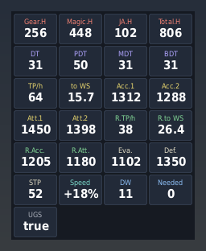
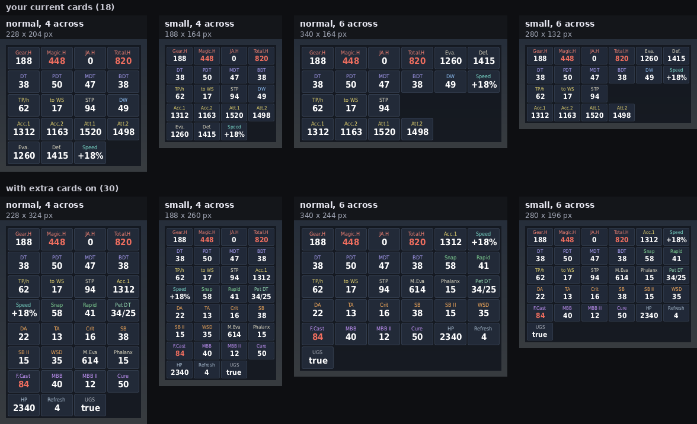
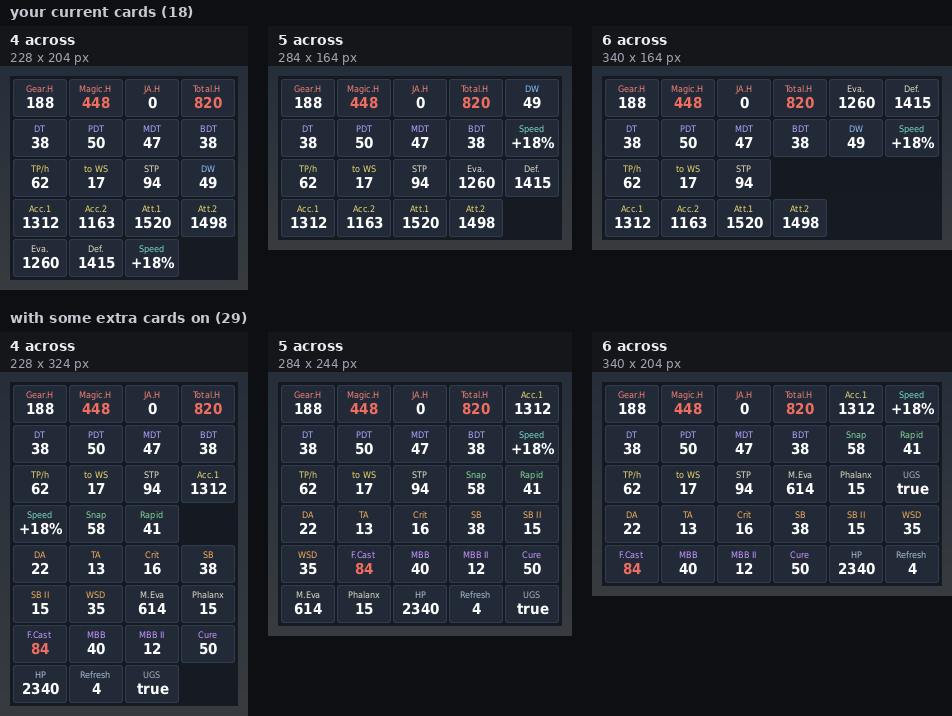
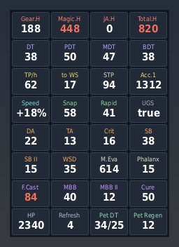

# InfoGear v1.23

InfoGear is a patched and restructured fork of **GearInfo** by Sebyg666 (https://github.com/sebyg666/GearInfo),
based on GearInfo 1.7.2.9. See CHANGES.md in the package for everything that was fixed or changed.


This is a multi-purpose addon that tracks your currently equipped gear and buffs to display valuable information.

  
The addon can be used in conjunction with Gearswap to facilitate gear swapping.

**Commands:** `//ig` or `//infogear` (the original used `//gi`). `//ig help` lists everything.
The Gearswap command is still `gs c gearinfo ...`, so existing Gearswap files keep working.

The original wiki (https://github.com/sebyg666/GearInfo/wiki) still describes the features; replace `//gi` with `//ig`.

## Display (v1.4)

The widgets are drawn as flat dark cards, 4 across (228 px wide, the same width as the original), each with a small coloured caption over a big bold number, on a
plain dark panel. A number over its cap turns soft red. The old bracket tiles, header strips and logo are gone;
the only art is `textures/cards/card.png` and `textures/cards/panel.png`.



* Which cards are shown is still set with `//ig show ...` (`//ig show all`, `//ig hide`).
* **Speed** card (on by default, `//ig show speed` to toggle): your movement speed as +/- %, the same number as
  Windower's SpeedChecker addon (the game's own speed value, so gear, Flee, Bolt's Role, slows and weight all count;
  on a mount it's the mount's speed against walking). Red while you're slower than normal.
* `//ig scale <0.5-2>` resizes the whole display (1 = normal). Saved per character.
* `//ig columns 4|5|6` sets how many cards go in a row (4 by default, the original width). Wider is shorter:
  with 18 cards, 4 across is 228 x 204 px, 5 across 284 x 164, 6 across 340 x 164. At 4 the groups line up as rows
  (haste, then DT...). Saved per character.
* `//ig size small|normal` (v1.14): small cards (44 x 30 px instead of 54 x 38) with smaller text (6 / 9 pt
  instead of 7 / 11), about a third less space; columns and grouping stay as they are. Saved per character. With 18
  cards: normal 4 across 228 x 204, small 188 x 164; 6 across 340 x 164 / 280 x 132. Sizes are `card_sizes` in
  `Layouts.lua`. (`//ig scale` still works on top of either.)

  
* **Grouping** (v1.9): at any width, a group of cards (haste, DT, TP + STP, Acc/Att, ranged, Eva/Def, DW, MA, Speed,
  and each extra group) that fits in a row is never split over two rows; a bigger group wraps from the start of a
  row; small groups fill gaps left in earlier rows; UGS goes last (or in a gap). The order of the groups is
  `card_groups` at the top of `Layouts.lua`.

  
* Drag the panel to move it, as before.
* **Extra stat cards** (v1.7), all off until you turn them on. `//ig cards` lists them; `//ig show <name>` toggles
  one, `//ig show <group>` a whole group:

  | group | cards (name) | red when |
  |---|---|---|
  | `melee` | DA `da`, TA `ta`, QA `qa`, Crit `crit`, Crit.D `critdmg`, SB `sb`, SB II `sb2`, WSD `wsd`, PDL `pdl` | SB over 50; SB II over 50, or SB + SB II over 75 |
  | `ranged` | Snap `snap`, Rapid `rapid` | Snapshot over 70 |
  | `magic` | F.Cast `fc`, M.Acc `macc`, MAB `mab`, MBB `mbb`, MBB II `mbb2`, Cure `cure`, Cure II `cure2` | Fast Cast over 80, MBB over 40, Cure over 50, Cure II over 30 |
  | `tank` | M.Eva `meva`, MDB `mdb`, Phalanx `phalanx`, Enmity `enmity` | |
  | `misc` | HP `hp`, MP `mp`, Regen `regen`, Refresh `refresh`, Regain `regain`, TH `th` | |
  | `pet` | Pet Regen `petregen`: the Regen your gear gives your pet (every pet type together). Pet DT `petdt`: your pet's damage taken from your gear, **physical / magic** (e.g. `34/25`), every pet type together (Pet, Wyvern, Avatar, Automaton, Luopan lines, plus the DRG JSE neck's Wyvern DT). Only shown on a pet job: main BST, DRG, SMN, PUP or GEO, or /SMN, /BST. On DRG the wyvern's innate -40% is added on top (gear part capped at 50, total at 87.5) | either number over 50 |

  These are **your gear's** numbers (augments and set bonuses included), plus buffs InfoGear tracks for the same
  stat (GEO bubbles, rolls). Job traits, job points and merits aren't included.
  The first time 1.7 loads on a character it reads your saved gear again (one time, chat says so), so the new stats
  are known.

  
* **JSE neck ranks** (v1.10): the augmentable JSE necks (Futhark Torque, Knight's Beads, War. Beads... all 22 jobs,
  base / +1 / +2) get their rank bonuses added, e.g. Futhark Torque +2 R25: Damage taken -7%, HP+60, STR/MND+15.
  Windower can't read these from the item, so they come from `res/JSE_Neck_Ranks.lua` (max-rank values from
  [BG-Wiki](https://www.bg-wiki.com/ffxi/Category:JSE_Necks)). Exact at max rank; below it they are scaled by rank.
* **Limbus ranked accessories** (v1.11): Murky Ring, Murky Mantle, Alabaster Earring, Alabaster Mantle get their
  rank bonuses, exact for every rank R1-R30 (`res/Limbus_Ranks.lua`, from the FFXIAH thread "Augment Tables for
  Limbus Gear (r1 to 30)"). The Limbus racial armor (Hope / Trust / Bravery / Justice / Mercy sets, NQ / HQ1 / HQ2)
  and the Limbus weapons (Skia ... Telopanos) get their rank bonuses too (v1.20, `res/Limbus_Armor_Ranks.lua`): every
  armor piece ranks up the same way (the growth depends only on a stat's R30 value), reproducing the BG-Wiki tables
  of Sworn Crown / Sabatons, Prestige Platemail, Duty Crown, Clemency Somen and Revelation Platemail; R30 is exact.
  Weapons follow Telopanos Grip's table (every stat from R1), so the grips are exact at every rank.
* **Unity gear** (v1.11): all 215 Unity reward items, regenerated from the game's own item descriptions; items with
  two Unity stats (e.g. Imp. Wing Hairpin DEX and AGI) get both. Set your Unity rank with `//ig rank #`.
* `//ig why pet` / `//ig why dt` (v1.15): lists what each equipped item gives to Pet DT or to your DT / PDT / MDT /
  BDT, with the rank InfoGear read for ranked gear, and the total. Handy when a number looks wrong.
* **Per-character profiles:** every character has its own `data/<CharacterName>_settings.xml` with the panel
  position, scale and every `//ig show` toggle, so each character keeps its own display. Logging in on another
  character loads that character's profile, and chat says so:

  ```
  [InfoGear] Loaded profile layout for Valdimar.
  [InfoGear] Author: Valdimar @ Phoenix 1.23, based on GearInfo by Sebyg666
  ```
* At the top of `Layouts.lua`: `card_columns` (4, the default for `//ig columns`), `card_caption_size` / `card_value_size` (fonts), `card_order`, `card_caption_colors` and `card_alert` (the over-cap red).
